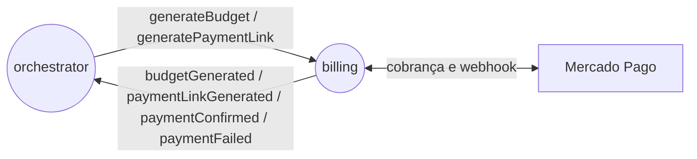
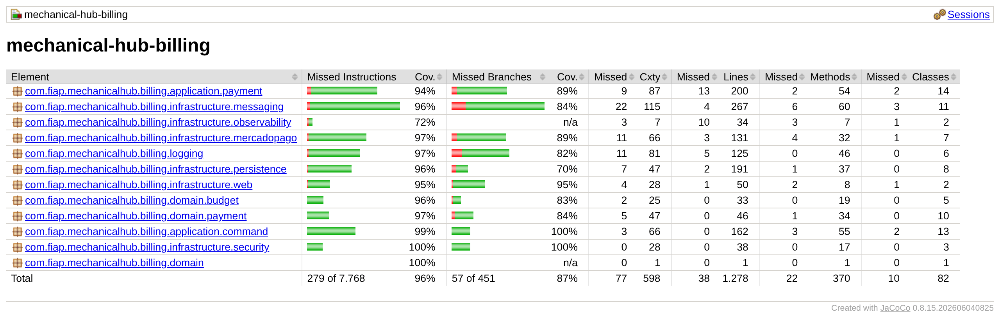

# mechanical-hub-billing

Dono de preço e pagamento no Mechanical Hub: calcula o orçamento da ordem com o preço do momento, cria a cobrança no Mercado Pago (Checkout Pro), confirma o pagamento pelo webhook e detecta o vencimento por um job.
Kotlin, Java 25, Spring Boot 4.1, PostgreSQL 16 (Flyway), Amazon SQS FIFO, Mercado Pago Orders API.

[](https://github.com/mechanical-hub-fiap/mechanical-hub-billing/actions/workflows/deploy.yml) [](https://sonarcloud.io/summary/new_code?id=mechanical-hub-billing) [](https://sonarcloud.io/summary/new_code?id=mechanical-hub-billing)

## Responsabilidade

- **Faz:** catálogo de preços (mão de obra por reparo, unitário por material), orçamento com preço congelado, cobrança no Mercado Pago, confirmação pelo webhook e vencimento em 24 h.
- **Não faz:** dados do cliente, status da ordem e notificações (`orders`), materiais e quantidades (`stock`), estado da saga (`orchestrator`), tela de pagamento (Checkout Pro).
- **Fora do escopo por enquanto:** cadastro de preços (FR-08), reembolso, histórico de preços com vigência e envio de dados do pagador. Detalhes em [Decisões e limitações](docs/mechanical-hub-billing-architecture-spec.md#9-decisões-e-limitações).

## Papel na saga



O orquestrador pede o orçamento depois que o estoque é reservado e o link de pagamento depois que o cliente aprova. O billing responde com `budgetGenerated` e `paymentLinkGenerated`. O pagamento é confirmado pelo webhook do Mercado Pago (`paymentConfirmed`); sem pagamento em 24 h, o job emite `paymentFailed`, que dispara a compensação. Estratégia: [RFC-0005](https://github.com/mechanical-hub-fiap/mechanical-hub-orchestrator/blob/main/docs/rfc/RFC-0005-saga-orquestrada.md) / [ADR-0005](https://github.com/mechanical-hub-fiap/mechanical-hub-orchestrator/blob/main/docs/adr/ADR-0005-divisao-em-microsservicos.md).

## Stack

| Linguagem/framework | Banco | Mensageria | Testes | Qualidade | Observabilidade |
|---|---|---|---|---|---|
| Kotlin, Java 25, Spring Boot 4.1 | PostgreSQL 16 + Flyway | Amazon SQS FIFO | JUnit, Testcontainers, WireMock | JaCoCo, ktlint, detekt, SonarQube Cloud | OpenTelemetry, Prometheus, Grafana |

## Como rodar

- **Pré-requisitos:** JDK 25 e Docker.
- **Dependências locais:** `docker compose up -d` sobe PostgreSQL 16, LocalStack (filas FIFO + DLQs de `localstack/init-queues.sh`) e WireMock simulando o Mercado Pago (porta 8089).
- **Variáveis de ambiente:** [`.env.example`](.env.example). Secrets: `MP_ACCESS_TOKEN` e `MP_WEBHOOK_SECRET`; sem chave AWS (na nuvem usa a `LabRole`). Prazo reduzido para demonstração: `BILLING_PAYMENT_DUE_DELAY=PT30M` (padrão `PT24H`).
- **Rodar e verificar:**

```bash
cp .env.example .env && docker compose up -d
./mvnw spring-boot:run
curl -s http://localhost:8080/actuator/health        # {"status":"UP"}
```

### Como testar no sandbox do Mercado Pago

1. No painel, crie a aplicação Checkout Pro, copie o access token `TEST-` para `MP_ACCESS_TOKEN` e a chave secreta do webhook para `MP_WEBHOOK_SECRET`; crie usuários de teste (vendedor e comprador).
2. Aponte `MP_BASE_URL=https://api.mercadopago.com` e configure no painel a URL do webhook (output `webhook_url` do `mechanical-hub-auth`, ou um túnel para `/webhooks/payment` localmente) a cada recriação do ambiente.
3. Envie `generateBudget` e `generatePaymentLink` na fila de comandos (ou deixe o orquestrador enviar) e abra o `paymentLink` de `paymentLinkGenerated`.
4. Pague com o comprador de teste: titular `APRO` aprova (`paymentConfirmed`), `OTHE` é recusado.
5. Expiração: suba com `BILLING_PAYMENT_DUE_DELAY` curto, não pague e aguarde o job: `paymentFailed` com `reason=EXPIRED`.

## API

| Método | Rota | Descrição |
|---|---|---|
| POST | `/webhooks/payment` | Notificação do Mercado Pago (pública, validada por `x-signature`) |
| GET | `/actuator/health/*`, `/actuator/prometheus` | Probes e métricas |

Postman: [`docs/api/mechanical-hub-billing.postman_collection.json`](docs/api/mechanical-hub-billing.postman_collection.json). Sem Swagger: a única rota de negócio é o webhook.

## Mensagens

- **Consome:** `generateBudget`, `generatePaymentLink`.
- **Publica:** `budgetGenerated`, `paymentLinkGenerated`, `paymentConfirmed`, `paymentFailed`.
- Contratos, filas e idempotência: [Interface assíncrona](docs/mechanical-hub-billing-architecture-spec.md#5-interface-assíncrona-mensagens).

## Dados

PostgreSQL, porque orçamento, itens e pagamentos são relacionados e exigem transações ACID com valores monetários exatos. Detalhes em [Modelo de dados](docs/mechanical-hub-billing-architecture-spec.md#6-modelo-de-dados).

## Testes e cobertura

```bash
./mvnw -q verify   # unitários, integração (Testcontainers: PostgreSQL + LocalStack + WireMock), ktlint, detekt e jacoco:check
```



Relatório JaCoCo da última execução completa de `verify` (2026-11-02): **97,0% de linhas** e 87,4% de branches. Meta: ≥ 80% (o build falha abaixo disso). Relatório em `target/site/jacoco/index.html` e no artefato `jacoco-report` do CI.

## CI/CD

Build → testes → SonarQube Cloud (quality gate) → imagem no ECR → deploy no EKS → smoke test. Workflow: [`deploy.yml`](.github/workflows/deploy.yml); executado também pela pipeline única [`deploy-all.yml`](https://github.com/mechanical-hub-fiap/mechanical-hub-infra/blob/main/.github/workflows/deploy-all.yml) do `mechanical-hub-infra`.

## Observabilidade

Logs JSON com `orderId`, `status`/`stage` e `mpOrderId` (sem tokens); métricas de pagamentos, webhooks, chamadas ao Mercado Pago e outbox no Prometheus; traces OpenTelemetry pelo SQS e pelas chamadas HTTP ao Mercado Pago. Padrão: [logging-standard](https://github.com/mechanical-hub-fiap/mechanical-hub-orchestrator/blob/main/docs/engineering/logging-standard.md).

## Documentação

- Arquitetura deste serviço: [`docs/mechanical-hub-billing-architecture-spec.md`](docs/mechanical-hub-billing-architecture-spec.md)
- Documentação do sistema: [diagrama](https://github.com/mechanical-hub-fiap/mechanical-hub-orchestrator/blob/main/docs/architecture/mechanicalHubFase4Diagrama-v2.png) · [saga](https://github.com/mechanical-hub-fiap/mechanical-hub-orchestrator/blob/main/docs/design/saga_transaction_status.md) · [ADRs](https://github.com/mechanical-hub-fiap/mechanical-hub-orchestrator/tree/main/docs/adr) · [RFCs](https://github.com/mechanical-hub-fiap/mechanical-hub-orchestrator/tree/main/docs/rfc) · [TDs](https://github.com/mechanical-hub-fiap/mechanical-hub-orchestrator/tree/main/docs/design/distributedTransaction) · [data model](https://github.com/mechanical-hub-fiap/mechanical-hub-orchestrator/blob/main/docs/design/data_model.md)
- Outros serviços: [mechanical-hub-orchestrator](https://github.com/mechanical-hub-fiap/mechanical-hub-orchestrator) · [mechanical-hub-orders](https://github.com/mechanical-hub-fiap/mechanical-hub-orders) · [mechanical-hub-stock](https://github.com/mechanical-hub-fiap/mechanical-hub-stock)
