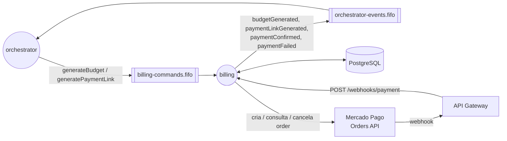

# mechanical-hub-billing — Arquitetura

Descreve o que o serviço faz e como está construído. Regras de negócio detalhadas e o passo a passo de cada fluxo ficam nos documentos do sistema, publicados em [`mechanical-hub-orchestrator/docs`](https://github.com/mechanical-hub-fiap/mechanical-hub-orchestrator/tree/main/docs).

## 1. Visão geral

O billing é o dono de preço e pagamento no Mechanical Hub. Calcula o orçamento da ordem com o preço do momento, cria a cobrança no Mercado Pago (Checkout Pro via Orders API), confirma o pagamento pelo webhook e detecta o vencimento por um job. Participa da saga recebendo comandos do orquestrador e respondendo com eventos.

## 2. Responsabilidades e fronteiras

**Dados que o serviço possui**

| Dado | Tabela |
|---|---|
| Preço de mão de obra por reparo | `service_prices` |
| Preço unitário por material | `material_prices` |
| Orçamentos e itens com o preço congelado no momento do cálculo | `budgets`, `budget_items` |
| Cobranças no Mercado Pago e seu estado | `payments` |

**O que ele não faz e quem faz**

| Assunto | Dono |
|---|---|
| Dados do cliente, status da ordem e notificações (inclusive o envio do link de pagamento) | `orders` |
| Materiais e quantidades reservadas | `stock` (chegam no comando `generateBudget`) |
| Estado da saga e decisão do próximo passo | `orchestrator` |
| Tela de pagamento | Checkout Pro do Mercado Pago |

O e-mail do pagador não é enviado ao Mercado Pago (`payer` omitido): o billing não tem dado pessoal do cliente e o cliente o informa na própria tela do Checkout Pro ([RFC-0007](https://github.com/mechanical-hub-fiap/mechanical-hub-orchestrator/blob/main/docs/rfc/RFC-0007-integracao-mercado-pago.md)).

## 3. Estrutura interna

Clean Architecture, com dependências apontando para dentro (`infrastructure → application → domain`):

| Pacote | Conteúdo | Pode depender de |
|---|---|---|
| `domain/budget` | `Budget` (cálculo de `laborTotal`, `materialTotal`, `orderCost`), `BudgetItem` | nada |
| `domain/payment` | `Payment` e transições condicionais, `PaymentDeadlines`, `ExpirationRules` (decisão do job como função pura), `ExpirationDecision` | nada |
| `application/command` | `GenerateBudgetUseCase`, `GeneratePaymentLinkUseCase`, inbox (`InboxResponder`, `InboxCleanup`) e portas (`PriceCatalog`, `BudgetStore`, `PaymentLinkStore`, `InboxStore`) | `domain` |
| `application/payment` | `ConfirmPaymentUseCase` (webhook), `ExpirePaymentsUseCase` (job), portas `PaymentGateway`, `PaymentStore`, `EventOutbox`, `TransactionRunner` | `domain` |
| `infrastructure` | Adapters JDBC, cliente HTTP do Mercado Pago, validador de assinatura, listener SQS, relay do outbox, job de vencimento, controller do webhook, segurança e métricas | `application`, `domain` |
| `logging` | `FlowLog`: logs de etapa no formato do padrão de logs | — |

Componentes principais:

| Componente | Papel |
|---|---|
| `SqsCommandListener` + `CommandProcessor` | Consomem os comandos, deduplicam pelo inbox e classificam erros (transitório × permanente) |
| `MercadoPagoPaymentGateway` | `createOrder`, `getOrder`, `cancelOrder`; timeouts de 2 s (conexão) e 5 s (leitura), sem retry no cliente |
| `WebhookSignatureValidator` | Valida `x-signature` (HMAC SHA-256 sobre `id`, `request-id` e `ts`) |
| `PaymentWebhookController` | Recebe a notificação do Mercado Pago e aciona o `ConfirmPaymentUseCase` |
| `PaymentExpirationJob` | A cada 5 min, na instância líder, cancela no MP as cobranças vencidas e decide o desfecho |
| `OutboxRelay` + `SqsOutboxMessageSender` | Publicam os eventos pendentes, só na instância líder |
| `GatewayAuthenticationFilter` | Exige os headers do API Gateway em toda rota que não seja pública |

## 4. Interface síncrona (REST)

| Método | Rota | Quem chama | Autenticação | Resposta / erros |
|---|---|---|---|---|
| POST | `/webhooks/payment` | Mercado Pago, via API Gateway (rota pública, sem autorizador) | `x-signature` + `x-request-id` (HMAC com `MP_WEBHOOK_SECRET`) | `200` processado ou repetido (sem efeito); `401` assinatura inválida; `500` falha transitória (o MP reenvia). Responde em até 22 s |
| GET | `/actuator/health/**`, `/actuator/prometheus` | Kubernetes / Prometheus | — | Probes e métricas |

Fluxo do webhook: valida a assinatura → consulta `GET /v1/orders/{data.id}` fora da transação → se `processed` + `accredited`, transição `PENDING → APPROVED` com `FOR UPDATE` e outbox `paymentConfirmed` na mesma transação. Pagamento fora de `PENDING` → `200` sem efeito (`processed` em pagamento `CANCELED` gera log de erro e o alerta `PAID_ON_CANCELED`).

Collection Postman: [`docs/api/mechanical-hub-billing.postman_collection.json`](api/mechanical-hub-billing.postman_collection.json) (webhook, actuator e corpos dos comandos). Não há Swagger: a única rota de negócio é o webhook.

## 5. Interface assíncrona (mensagens)

### 5.1 Envelope e convenções

JSON em filas SQS FIFO, com `eventId`, `transactionId`, `orderId`, `type`, `version`, `timestamp` + payload. `MessageGroupId = orderId` e `MessageDeduplicationId = eventId`. Os comandos recebidos trazem `idempotencyKey = {transactionId}:{STEP}`, usada como chave do `inbox_events`. O contexto de trace viaja nos *message attributes*.

### 5.2 Filas

| Direção | Fila | DLQ |
|---|---|---|
| Lê | `mechanical-hub-billing-commands.fifo` | `mechanical-hub-billing-commands-dlq.fifo` |
| Escreve | `mechanical-hub-orchestrator-events.fifo` | — |

### 5.3 Mensagens consumidas

| Tipo | Fila | Payload | Efeito no serviço | Idempotência |
|---|---|---|---|---|
| `generateBudget` | billing-commands | `repairs[{repairId}]`, `reservedMaterials[{materialId, quantity}]` | Busca o preço de cada reparo e material, calcula os totais e grava `budgets` + `budget_items` com o preço do momento. Reparo ou material sem preço → erro permanente | `inbox_events` por `{transactionId}:GENERATE_BUDGET`; duplicata regrava a resposta guardada no outbox |
| `generatePaymentLink` | billing-commands | `budgetId`, `orderCost` | Reaproveita um pagamento `PENDING` da transação se existir; senão chama `POST /v1/orders` **fora da transação** e grava `payments` (`due_at` = +24 h, `expires_at` = +24 h 05) numa transação separada | Inbox + `X-Idempotency-Key = {transactionId}:GENERATE_PAYMENT_LINK` no Mercado Pago |

### 5.4 Mensagens publicadas

| Tipo | Fila | Payload | Quando é emitida |
|---|---|---|---|
| `budgetGenerated` | orchestrator-events | `budgetId`, `orderCost` | Após `generateBudget` |
| `paymentLinkGenerated` | orchestrator-events | `paymentLink` (`checkout_url`), `expiresAt` (`due_at`) | Após `generatePaymentLink` |
| `paymentConfirmed` | orchestrator-events | `paymentId` | Webhook com order paga, ou job que encontra a order paga |
| `paymentFailed` | orchestrator-events | `reason` (`EXPIRED` / `FAILED`) | Job confirma vencimento ou falha da cobrança |

## 6. Modelo de dados

PostgreSQL 16 (RDS próprio, provisionado pelo `mechanical-hub-database`), migrations Flyway. Relacional porque orçamento, itens e pagamentos são fortemente ligados e exigem transações ACID; valores monetários em `NUMERIC(12,2)` / `BigDecimal`.

| Tabela | Conteúdo | Chaves e índices |
|---|---|---|
| `service_prices` | `service_id` (= `repairId`), `labor_price` | PK `service_id` |
| `material_prices` | `material_id`, `unit_price` | PK `material_id` |
| `budgets` | `budget_id`, `order_id`, `transaction_id`, `labor_total`, `material_total`, `total` | índice `transaction_id` |
| `budget_items` | `item_type` (`REPAIR`/`MATERIAL`), `item_ref`, `quantity`, `unit_price`, `total_price` | FK `budget_id` |
| `payments` | `mp_order_id`, `checkout_url`, `amount`, `status` (`PENDING`/`APPROVED`/`CANCELED`), `mp_status`, `due_at`, `expires_at`, `paid_at`, `canceled_at` | UK `mp_order_id`; índices `(status, due_at)` para o job e `transaction_id`; FK `budget_id` |
| `outbox_events` | `sequence`, `event_id`, `aggregate_id`, `event_type`, `payload` (JSONB), `status`, `attempts`, `last_error` | UK `event_id`; índice `(status, sequence)` |
| `inbox_events` | `message_key`, `response_payload`, `processed_at` | PK `message_key`; índice `processed_at` |

- **Limpeza:** job diário (03:00) apaga `inbox_events` com mais de 30 dias. O outbox é permanente.
- **Migrations:** `V1` tabelas de preço, `V2` orçamento e pagamento, `V3` outbox/inbox, `V4` catálogo fixo de preços, com os mesmos UUIDs de reparos e materiais usados por `orders` e `stock`. Não há endpoint de cadastro de preço.

## 7. Consistência e tratamento de falhas

- **Atomicidade:** toda alteração e o evento correspondente são gravados na mesma transação (alteração + `outbox_events`). A chamada ao Mercado Pago nunca fica dentro de uma transação: antes dela há a deduplicação e a busca de pagamento `PENDING`; depois, a gravação em transação própria.
- **Retry:** erro transitório (banco, timeout, 5xx/429 do MP) não apaga a mensagem e ajusta o *visibility timeout* pela `ApproximateReceiveCount` (1 s → 8 s); DLQ nativa após 6 recebimentos. `SET LOCAL lock_timeout = '5s'` nas transações do consumidor.
- **DLQ:** erro permanente (contrato inválido, preço ausente, 400/401/403/404 do MP) vai direto à DLQ.
- **Duplicada:** o inbox devolve a resposta já gravada; no Mercado Pago a mesma `X-Idempotency-Key` devolve a mesma order.
- **Fora de ordem / corrida:** transições condicionais `PENDING → APPROVED` e `PENDING → CANCELED` com `FOR UPDATE` garantem um único desfecho quando webhook e job chegam juntos (um só `paymentConfirmed`).
- **Job de vencimento:** a cada 5 min, só na instância líder (`pg_try_advisory_lock` com chave própria), seleciona até 100 pagamentos `PENDING` vencidos, chama `POST /v1/orders/{id}/cancel` e decide pelo resultado: cancelada → `paymentFailed(EXPIRED)`; `409` → consulta e decide entre pago, expirado, falho ou aguardar o próximo ciclo.
- **Papel nas compensações:** o billing dispara a compensação de pagamento não confirmado emitindo `paymentFailed`; o orquestrador então cancela a ordem e devolve o estoque. Não há reembolso.

## 8. Observabilidade

- **Logs:** JSON com mensagem em logfmt conforme o [padrão de logs](https://github.com/mechanical-hub-fiap/mechanical-hub-orchestrator/blob/main/docs/engineering/logging-standard.md): `orderId`, `status`, `stage`, `attempt`, `durationMs` e contexto (`budgetId`, `orderCost`, `mpOrderId`, `paymentStatus`); nunca tokens nem o corpo da assinatura.
- **Métricas** (`/actuator/prometheus`): `outbox_oldest_pending_age_seconds`, `billing_payments{status}`, `billing_payment_failed_total{reason}`, `billing_webhook_total{result}`, `mercadopago_request_seconds{operation, status}`, `billing_alerts_total{type}`. Regra de alerta em `monitoring/billing-alerts.rules.yaml`.
- **Traces:** agente OpenTelemetry; o trace atravessa o SQS e as chamadas HTTP ao Mercado Pago.

## 9. Decisões e limitações

Decisões relacionadas:

- [RFC-0007 — Integração com o Mercado Pago](https://github.com/mechanical-hub-fiap/mechanical-hub-orchestrator/blob/main/docs/rfc/RFC-0007-integracao-mercado-pago.md) e [desenho da integração](https://github.com/mechanical-hub-fiap/mechanical-hub-orchestrator/blob/main/docs/design/integrations/mp_payment_api_integration.md)
- [RFC-0005 — Saga orquestrada](https://github.com/mechanical-hub-fiap/mechanical-hub-orchestrator/blob/main/docs/rfc/RFC-0005-saga-orquestrada.md)
- [ADR-0004 — Banco de dados por microsserviço](https://github.com/mechanical-hub-fiap/mechanical-hub-orchestrator/blob/main/docs/adr/ADR-0004-banco-de-dados-por-microsservico.md)
- [ADR-0007 — Outbox e inbox](https://github.com/mechanical-hub-fiap/mechanical-hub-orchestrator/blob/main/docs/adr/ADR-0007-outbox-e-inbox.md)
- Fluxos: [ordem completa](https://github.com/mechanical-hub-fiap/mechanical-hub-orchestrator/blob/main/docs/design/distributedTransaction/td_finished_os.md) (passos 9, 14 e 17) e [pagamento não confirmado](https://github.com/mechanical-hub-fiap/mechanical-hub-orchestrator/blob/main/docs/design/distributedTransaction/td_payment_failed.md) (F1–F3′)

Fora do escopo por enquanto (requisitos futuros):

- Cadastro de preços: o catálogo é fixo nas migrations (FR-08).
- Reembolso e histórico de preços com vigência; o preço do momento fica congelado em `budget_items`.
- Envio de dados do pagador ao Mercado Pago.
